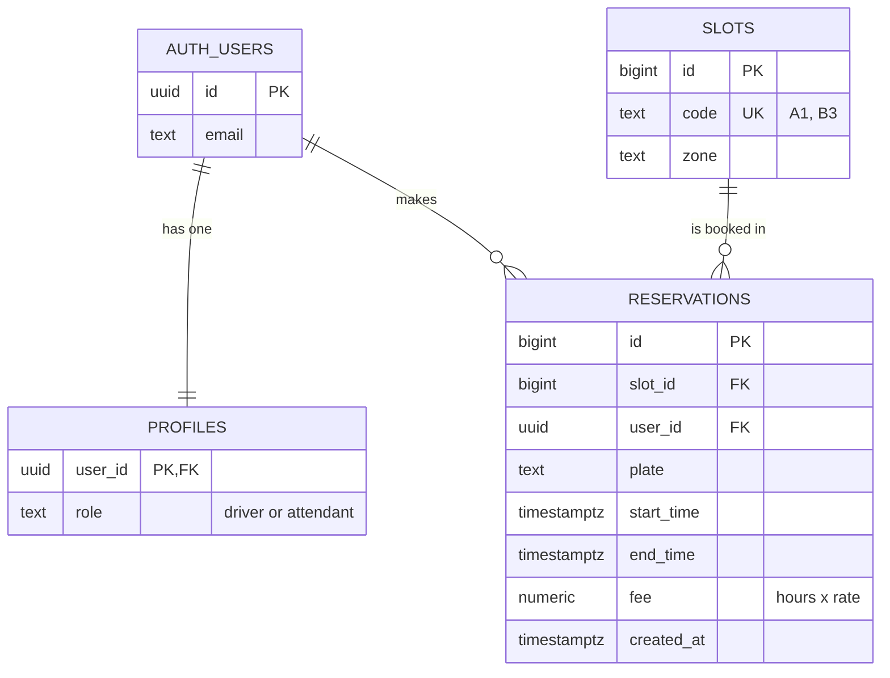
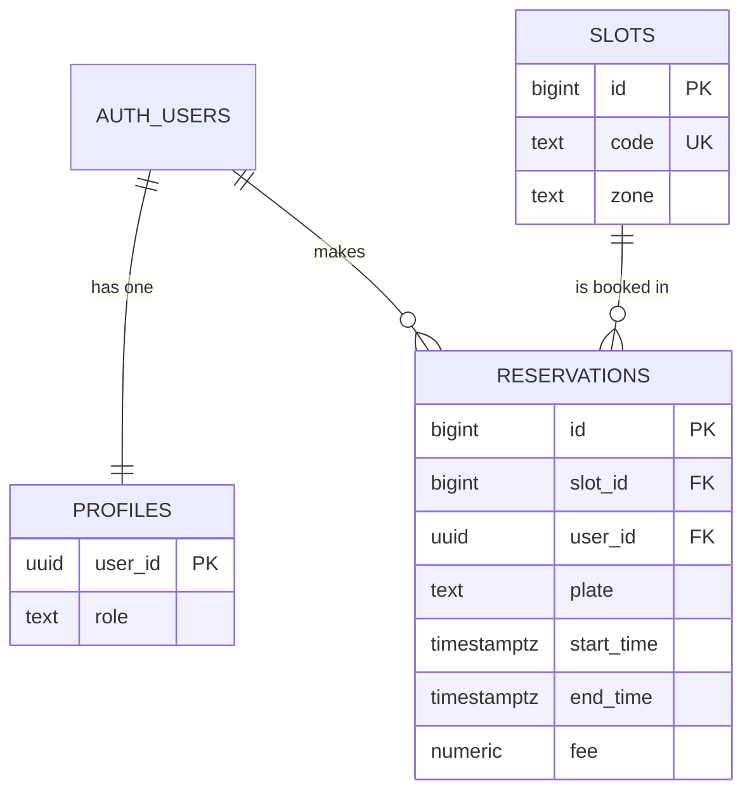

# Data model

| Table | Purpose | Key rules |
|---|---|---|
| `auth.users` | Created and managed by Supabase Auth (email, password hash). | Not edited by hand. |
| `profiles` | One row per user holding the **role** (`driver` or `attendant`). A database trigger creates it as `driver` at sign-up. | `role` must be one of the two values. |
| `slots` | The parking places. | `code` is unique; `code`, `zone` NOT NULL. |
| `reservations` | One booking of one slot for a time range. | `slot_id` and `user_id` are foreign keys; `end_time > start_time`; **exclusion constraint `no_overlap`** stops two overlapping ranges on the same slot. |

Entities came from the nouns in the user stories: *driver, attendant, slot, reservation*.
